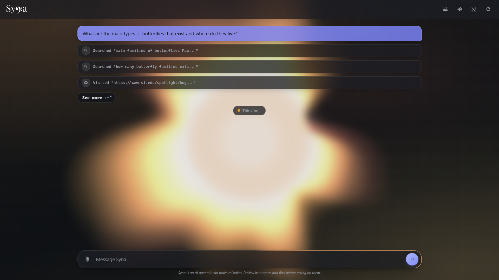
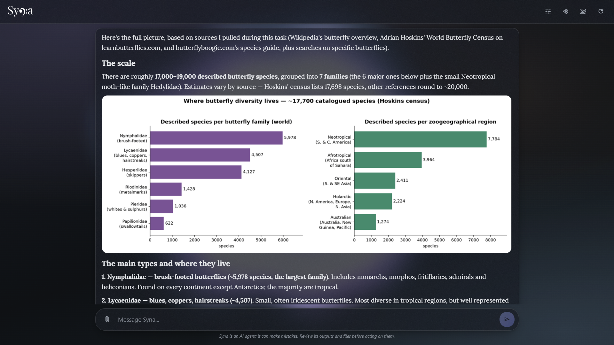

<p align="center">
  
</p>

<h3 align="center">Syna</h3>
<p align="center">
  <i>The AI agent with a pod.</i>
  <br />
  <a href="https://julynx.github.io/syna/" target="_blank">julynx.github.io/syna</a>
</p>

<hr />

<p align="center">
  <h3 align="center"><code>uv tool install syna-agent</code></h3>
</p>





## Features

- **A sandboxed pod.** Every command runs inside an isolated container, with a full Debian shell, root access, and your host machine out of reach.
- **A complete toolset.** Web search and browser automation (both local, no API key), image understanding, image generation, speech-to-text, text-to-speech, and precise line-number, diff-style file editing.
- **Built for long, complex tasks.** Every tool output is saved to a file, context is managed automatically (elision and compaction, with a high cache hit rate), and deliverables keep a verifiable chain of custody from source to artifact.
- **Honest reporting.** Syna is trained to say exactly what happened and what it can't verify; it resists prompt injection and false-flag attacks baked into web content, and it scores at the top of honesty benchmarks.
- **It asks when it should.** Multiple-choice or open-ended questions, mid-task, whenever a decision isn't Syna's to make.
- **Voice mode.** Talk to it, and it reads its answers out loud.
- **A beautiful UI.** Frosted glass, sound effects, and a Y2K-video-player-style background visualizer that reacts to the agent (thinking, calling tools, speaking).
- **Any provider.** Works with OpenRouter (recommended, most tested), OpenAI, Google Gemini, local Ollama, or any OpenAI-compatible endpoint.

## Getting started

1. Install:

   ```bash
   uv tool install syna-agent
   ```

2. Run the setup wizard and follow the steps (dependencies, provider, API key, sanity check):

   ```bash
   syna-setup
   ```

3. Start Syna (the web UI at `http://127.0.0.1:8000`, or the terminal CLI):

   ```bash
   syna        # Starts the web UI (and first-run wizard if not configured)
   syna-cli    # Starts the terminal CLI
   ```

The wizard writes a `.env` file in `~/.syna` for you. To configure manually, create `~/.syna/.env` with:

```sh
OPENROUTER_API_KEY=your-api-key
MODEL=~z-ai/glm-flash-latest        # Or any model of your preference
BASE_URL=https://openrouter.ai/api/v1   # Optional: any OpenAI-compatible endpoint
THINKING_EFFORT=medium          # Can be either of none|minimal|low|medium|high|xhigh|max
```

Voice mode is enabled by adding speech models to the same `.env` file:

```sh
STT_MODEL=google/chirp-3                    # Transcribes microphone recordings
TTS_MODEL=google/gemini-3.8-flash-lite-tts  # Reads the answers out loud
TTS_VOICE=Kore                              # Optional: voice of the TTS model
SPEECH_LANGUAGE=en                          # Optional: ISO-639-1 code, English by default
```

Image generation (the model's `text_to_image` tool) is enabled the same way:

```sh
IMAGE_MODEL=google/gemini-3.1-flash-image
```

Requirements: Python 3.12+ and a container engine (Podman or Docker; the setup wizard checks and installs one for you).

## Privacy

Syna does not collect your personal information or send your messages anywhere except to the provider you specified. Their Terms of Service and Privacy Policy apply.

## Links

- [Website](https://julynx.github.io/syna/)
- [PyPI](https://pypi.org/project/syna-agent/)
- [Technical description](docs/technical_description.md)
- [Report an issue](https://github.com/Julynx/syna/issues)
